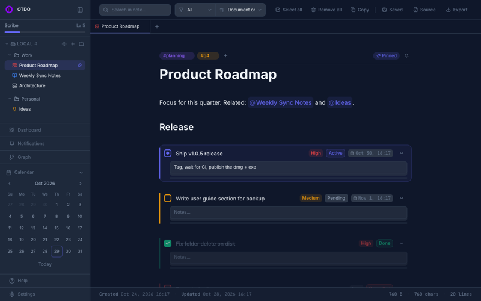
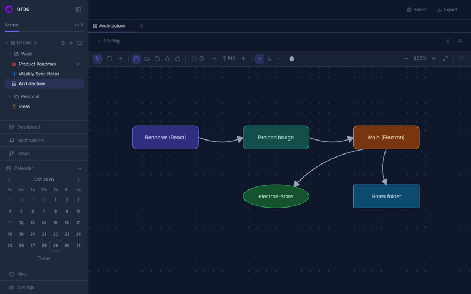
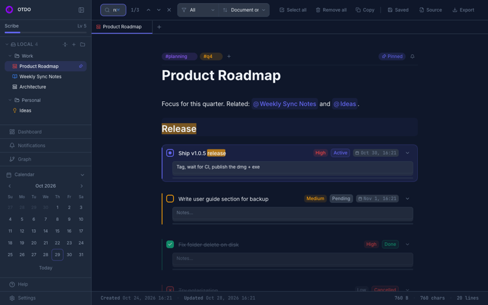
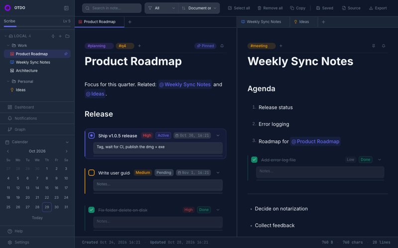
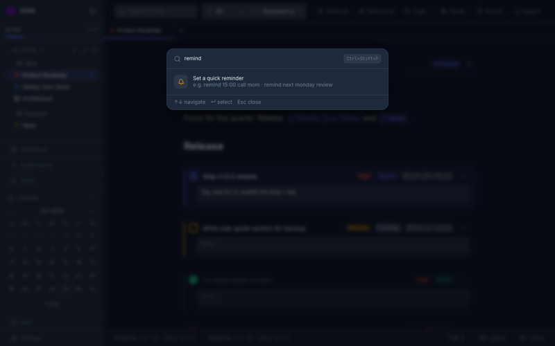
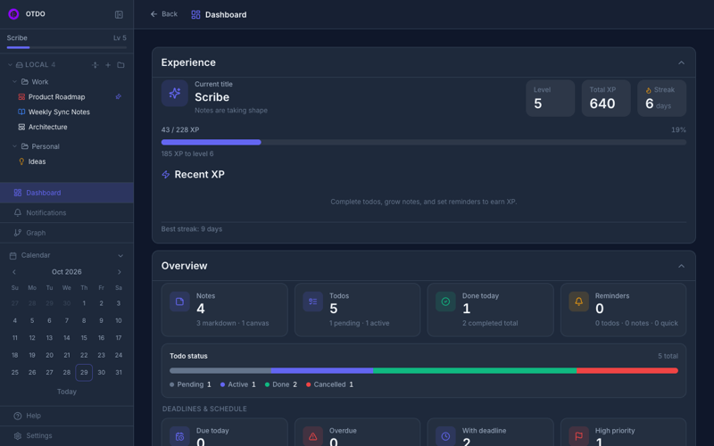

# OTDO

OTDO is a desktop **todo & note-taking** app built with **React + Electron + Tailwind CSS**. It combines a Notion-style block editor, **canvas diagram notes**, tabbed/split views, local + Google Drive storage, embedded tasks, layered reminders, Dashboard/XP, Telegram, and Google Drive integrations.

> **User guide:** For day-to-day usage, shortcuts, and integration setup, see [`USER_GUIDE.md`](./USER_GUIDE.md) (Turkish).

## Screenshots

<table>
  <tr>
    <td width="50%"><br><sub><b>Block editor</b> — headings, lists, code, <code>@mentions</code>, <code>#tags</code>, embedded todos with priority, status and due date</sub></td>
    <td width="50%"><br><sub><b>Canvas notes</b> — shapes and arrows for diagrams, exported as PNG / JPG / JSON</sub></td>
  </tr>
  <tr>
    <td width="50%"><br><sub><b>Search</b> — matches highlighted inside block text and todo title / description</sub></td>
    <td width="50%"><br><sub><b>Tabs &amp; split view</b> — several notes side by side, pinned tabs, context menu</sub></td>
  </tr>
  <tr>
    <td width="50%"><br><sub><b>Command palette</b> — open notes, create notes, set a quick reminder (<code>⌘⇧P</code>)</sub></td>
    <td width="50%"><br><sub><b>Dashboard</b> — XP, level, streak, todo status and deadlines</sub></td>
  </tr>
</table>

## Features

### Notes & editor
- **Two note types** — **Note** (markdown / block editor) and **Canvas** (shapes + arrows, `.canvas.json`)
- **Block editor** — Paragraph, headings (H1–H3), lists, quote, code, table, divider, link, todo; `/today` `/date` `/time` inserts
- **Slash commands** — `/` to insert blocks; todos support priority, due date, and reminder form
- **Inline formatting** — Bold, italic, strikethrough, code, color, link; floating toolbar + shortcuts (`⌘B` / `⌘I` / `⌘K` …)
- **Note mentions** — `@` to link other notes; edges appear in Graph
- **#tags** — Free-form tags via NoteTagsBar; used in search and command palette
- **Pin & appearance** — Sidebar pin order; icon + color labels (Important / Warning / Info / Temp)
- **Tabs & split** — Multiple tabs, split right/down, tab pin, context menu
- **Source view** — Raw markdown panel (markdown notes only)
- **In-note search** — Content + tag search (`⌘F`); matches are highlighted inside block text and in todo title / description
- **Todo filter / sort** — Status filter and Priority / Due / Created sort
- **Command palette** — Open notes, New Local/Drive Note, **quick reminder** (`remind` / `hatırlat`)
- **Autosave** — Configurable delay for local + Drive
- **Folder tree** — Local / Drive sections, drag-and-drop reorder, nested folders; deleting a folder moves its notes to Trash and removes the (now empty) folder from disk
- **Notes folder scan** — Existing `.md` / `.canvas.json` files under the Notes Folder Path are picked up on every launch; **Sync from folder** in Settings → Local Storage does it on demand
- **Trash** — Soft delete to `.otdo-trash`; restore, permanent delete, empty trash; retention 7–60 days
- **Calendar notes** — Journal notes from the sidebar calendar (`calendar` folder)
- **Graph** — `@mention` relationship map (zoom / pan / fit)
- **Export** — Markdown: HTML, PDF, PNG, JPG, MD · Canvas: PNG, JPG, JSON

### Canvas
- Shapes: rounded, rectangle, ellipse, diamond, parallelogram
- Connection arrows: one-way / two-way / none; connection color
- Font size S–XL; pan / zoom / fit; PNG/JPG/JSON export

### Tasks (Todos)
- **Embedded todo blocks** — Tasks inside notes; linked via `todoId` in markdown
- **Status** — `pending` → `in-progress` → `done` / `cancelled`
- **Priority** — `high`, `medium`, `low`
- **Dates** — Start, Due, Cancel
- **Reminders** — Once / Hourly / Daily / Weekly / Monthly
- **Desktop notification** + optional **Telegram** message
- **macOS reminder sounds** — System default, silent, or built-in system sounds (Ping, Glass, …) with Preview

### Reminders (three scopes)
| Type | Source |
|------|--------|
| Todo reminder | Todo detail panel |
| Note reminder | NoteTagsBar → Reminder (list of open tasks) |
| Quick reminder | Command palette (`remind …`) |

Active schedules and history live on the **Notifications** page. Scheduling uses wall-clock time in the Electron main process (re-armed after sleep / App Nap / window focus) while the app is open.

### Dashboard & gamification
- Overview stats, deadlines, note/Drive/calendar counts
- XP, level, titles (Novice → Legend), streak, recent XP
- **XP toasts** + level-up toasts on earn
- Activity report (Daily/Monthly) + CSV / Markdown export

### Integrations
- **Google Drive** — Your own OAuth credentials; auto-sync; **Import from Drive folder** (`.md` + `.canvas.json`)
- **Telegram Bot** — Todo / note / quick reminder messages; `/list`, `/today`, `/search`, `/help`

### Backup & restore
- **Settings → Backup** exports the whole app state (notes metadata incl. icons / colors / tags / pins, todos, settings, gamification, Drive / Telegram credentials) to one JSON file
- Restore keeps your current Notes Folder Path and rebases note file paths onto it
- Note **files are not included** — copy your notes folder separately, set it as the Notes Folder Path, then restore

### Diagnostics
- Uncaught errors (main + renderer) and `console.error` output are appended to `errors.txt` in the userData folder (rotated at 1 MB) for later troubleshooting

### UI
- **Dark theme** only (light theme planned)
- Configurable editor (line numbers, spell check, font, padding, max width, alignment)
- Sidebar hide/show; Help overlay
- macOS title bar; dock badge for unread notifications

## Requirements

- Node.js 18+
- npm

## Setup & run

```bash
npm install          # Install dependencies
npm run dev          # Vite + Electron (development)
npm run build        # Production build (dist + electron-builder)
npm run electron     # Electron against built dist
npm run icons:mac    # Generate macOS icon
```

`npm run dev` → Vite at `http://localhost:5173`, Electron window opens automatically.

## Releases (GitHub Actions)

Pushing a tag `v*` runs `.github/workflows/release.yml`, which builds on macOS (dmg + zip, arm64 and x64) and Windows (NSIS `.exe`, x64) and attaches the files to a GitHub Release.

```bash
# 1. bump "version" in package.json and merge it (the workflow fails if the tag and version differ)
git tag v1.0.6 && git push origin v1.0.6
```

macOS builds are **ad-hoc signed** (`scripts/adhoc-sign.js`) but not notarized, so on first launch macOS may say Apple cannot verify the app. Open **System Settings → Privacy & Security → Open Anyway**, or run `xattr -cr /Applications/OTDO.app`. Pick the `arm64` build on Apple Silicon and the `x64` build on Intel Macs. Removing the warning entirely needs an Apple Developer ID certificate and notarization.

## Mac release build

### 1. Version & metadata

Update the top-level fields in `package.json`:

```json
{
  "name": "otdo",
  "version": "1.0.6",
  "description": "OTDO - Simple Todo & Note App",
  "author": "Your Name <email@example.com>"
}
```

| Field | Purpose |
|-------|---------|
| `version` | Appears in output names (`OTDO-1.0.6-arm64.dmg`) |
| `author` | Clears electron-builder author warnings; package metadata |

### 2. Icon (optional)

If `build/icon.png` (1024×1024 recommended) changed:

```bash
npm run icons:mac
```

Produces `build/icon.icns`.

### 3. Build commands

```bash
# Signed build (requires Developer ID certificate)
npm run build:mac

# Unsigned build — local testing / internal distribution
npm run build:mac:unsigned
```

### 4. Outputs

After a successful build, under `dist-electron/`:

| File | Description |
|------|-------------|
| `OTDO-{version}-arm64.dmg` | Installer disk image |
| `OTDO-{version}-arm64-mac.zip` | Zip package |
| `mac-arm64/OTDO.app` | Runnable app bundle |

### 5. Post-build smoke test

1. Open the `.dmg` (or run `OTDO.app` directly) and install if needed
2. Create a note / canvas, set a reminder; try Drive/Telegram if configured
3. Gatekeeper (not notarized): right-click → **Open**, or **Open Anyway** in Privacy & Security

### 6. Public distribution (later)

Apple **Developer ID** signing + **notarization** are required. For personal testing, `build:mac:unsigned` is enough.

```bash
security find-identity -v -p codesigning
export CSC_NAME="Developer ID Application: Your Name (TEAM_ID)"
npm run build:mac
```

## Pages

| Route | Component | Description |
|-------|-----------|-------------|
| `/` | `EditorPage` | Block / canvas editor, tabs, split, search, export |
| `/dashboard` | `DashboardPage` | Stats, XP, activity report |
| `/notifications` | `NotificationsPage` | Active reminders + history |
| `/graph` | `GraphPage` | `@mention` note graph |
| `/help` | `HelpPage` | XP, shortcuts, remind examples |
| `/settings` | `SettingsPage` | Appearance, editor, notifications, tasks, storage, Drive, Telegram |

## Architecture

```
Renderer (React + Zustand)  ←→  Preload (contextBridge)  ←→  Main (Electron)
     src/                           electron/preload.js         electron/main.js
```

| Layer | Responsibility |
|-------|----------------|
| **Main** | File I/O (text + base64), `electron-store`, notifications, reminder timers, Google OAuth callback, dock badge |
| **Preload** | `window.api` — safe IPC bridge |
| **Renderer** | UI, state, Drive/Telegram/export services |

### Startup flow

1. `settingsStore.init()` — Settings, Drive session
2. `todoStore.init()` — Todos + reminders
3. `noteStore.init()` — Note/folder meta, drafts, note reminders, trash purge
4. `notificationStore.init()` / `quickReminderStore.init()` / `gamificationStore.init()`
5. Telegram polling (~5s) when configured

## Data storage

| Data | Location | Format |
|------|----------|--------|
| Markdown notes | `notesPath` | `.md` |
| Canvas notes | `notesPath` | `.canvas.json` |
| Trashed notes | `notesPath/.otdo-trash` | same + meta `deletedAt` |
| Note/folder meta + editor layout | `electron-store` → `notesMeta` | JSON |
| Todos | `electron-store` → `todos` | JSON |
| Settings | `electron-store` → `settings` | JSON |
| Notification history | `electron-store` → `notifications` | JSON |
| Quick reminders | `electron-store` → `quickReminders` | JSON |
| Gamification (XP) | `electron-store` → `gamification` | JSON |

macOS userData: `~/Library/Application Support/OTDO` (also holds `errors.txt`)

Todo blocks in markdown link to todo records via `<!--todo:uuid-->` comments.

## IPC API (`window.api`)

```js
window.api.store.get/set/delete/getAll
window.api.fs.readFile/writeFile/listDir/mkdir/deleteFile/rmdir/exists/rename
// writeFile(path, content, { encoding: 'base64' }) — binary export
window.api.dialog.openDirectory/openFile/saveFile
window.api.log.error(msg) / reveal()
window.api.notify(title, body)
window.api.reminder.schedule(id, config) / cancel(id) / list() / previewSound(sound)
window.api.onNotificationPush(cb) / onReminderExpired(cb)
window.api.oauth.googleDriveConnect(creds) / googleDriveCancel()
window.api.dock.setBadge(count)
window.api.shell.openExternal(url)
window.api.platform / isElectron
```

## State (Zustand)

| Store | File | Contents |
|-------|------|----------|
| `noteStore` | `src/store/noteStore.js` | Notes (`type`: markdown\|canvas), folders, tabs, drafts, note reminders, trash |
| `todoStore` | `src/store/todoStore.js` | Todo CRUD, reminders |
| `settingsStore` | `src/store/settingsStore.js` | Theme, editor, sounds, trash retention, integrations |
| `notificationStore` | `src/store/notificationStore.js` | Notification history, active reminder list |
| `quickReminderStore` | `src/store/quickReminderStore.js` | Standalone quick reminders |
| `gamificationStore` | `src/store/gamificationStore.js` | XP, level, streak, titles, toasts |

## Project layout

```
otdo/
├── electron/
│   ├── main.js              # IPC, reminders, OAuth, dock badge
│   ├── preload.js
│   ├── googleOAuth.js
│   ├── reminderSchedule.js
│   ├── reminderMessages.js
│   ├── reminderNotify.js
│   └── telegramSend.js
├── scripts/                 # fix-electron-name, adhoc-sign, icons
├── .github/workflows/       # release.yml (mac + windows installers)
├── docs/screenshots/        # README images
├── src/
│   ├── App.jsx              # HashRouter, store init, Telegram polling
│   ├── components/
│   │   ├── editor/          # BlockEditor, tabs, split, SlashMenu, tags
│   │   ├── canvas/          # CanvasEditor, CanvasExportModal
│   │   ├── dashboard/       # DashboardPage, XP, activity report
│   │   ├── notifications/   # NotificationsPage
│   │   ├── help/            # HelpPage
│   │   ├── graph/           # GraphPage, NoteGraphCanvas
│   │   ├── layout/          # Sidebar (incl. Trash), CommandPalette, calendar
│   │   ├── settings/        # SettingsPage, setup guides
│   │   ├── notes/           # NewNoteModal, ExportModal
│   │   ├── todos/           # TodoBlock UI, ReminderForm
│   │   └── common/          # Modal, ColorTag, XpToastStack, …
│   ├── store/
│   ├── services/            # exporter, googleDrive, telegram
│   └── lib/                 # blocks, noteCanvas, noteTrash, gamification,
│                            # remindCommandParser, noteGraph, reminderSounds,
│                            # notesFolderScan, appBackup, …
├── USER_GUIDE.md
├── CLAUDE.md                # Agent / developer notes
└── package.json
```

## Tech stack

| Layer | Technology |
|-------|------------|
| UI | React 18, React Router 6 |
| Desktop | Electron 33 |
| Styling | Tailwind CSS 3 |
| State | Zustand 5 |
| Build | Vite 6, electron-builder |
| Export | html2canvas, jsPDF; canvas → SVG → PNG/JPG |
| Storage | electron-store + filesystem |
| Icons | lucide-react |

## License

Private project.
